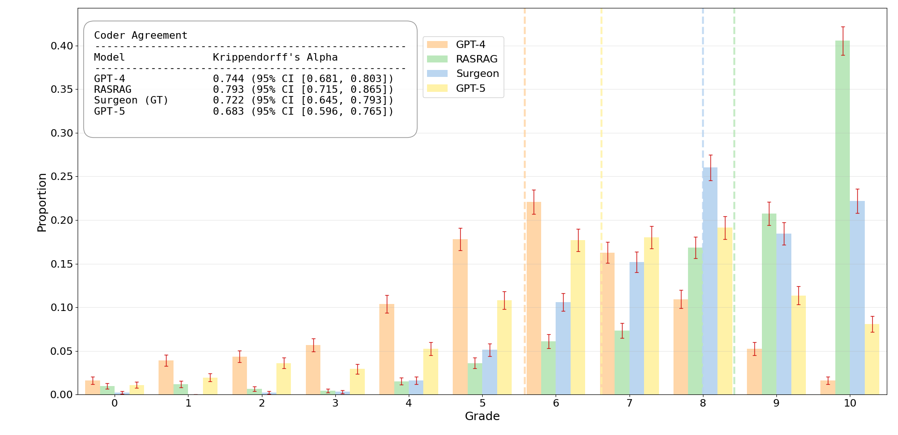
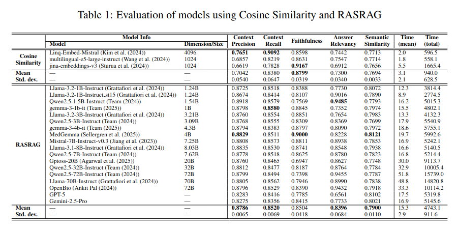

# JMIA

  
## Repository Description 
This repository provides all the code used for the research: **RASRAG: A Domain-Specific RAG Framework and Benchmark for Robotic-Assisted Surgery**. We plan to publicly share all documents upon paper acceptance.

You may find the following documents:

- **JMIA.xlsx**: This file contains the RAS QA benchmark, a subset of our RASRAG for the first textbook (*ras_texbook_sample*), alongside the corresponding benchmark QAs from the textbook (*RAS QA Sample*). It also includes the full table with answers for each model and RAG (from Tables 1 & 2), as well as the surgeon evaluation described in Section 3.3. For this evaluation, four QA sets (Ground Truth, GPT-4o, GPT-5, and RASRAG+Mistral-7B) were shuffled and reviewed by expert raters. For full transparency, we have included the shuffled and blinded QAs provided to the experts, the mapping of the shuffled QAs, and the grades reported in Figure 4 of the paper.



- **ras_qa_rag_eval.xlsx**: This file contains the evaluation results for all models discussed in Table 1. The *retrieved contents* from RASRAG have been removed, as they could be used to reconstruct the full dataset. These tables were generated using the RAGAS framework (see Section 3.1 for more details).



- **ras_qa_sample**, **ras_texbook_sample**: Also included in *JMIA.xlsx*, these are subsets of our dataset (specifically covering 3 procedures) made available to support the validity of our work.

- **tree_creation_book.py**, **RASRAG.py**: The RASRAG code described in Section 1. These scripts were used to generate the evaluation inputs for the RASRAG results in Tables 1 & 2 of the manuscript.

- **trad_cos_sim.py, embedding.py**: The equivalent script for the "classic" RAG used in Table 1 (Cosine Similarity).  


## Measurement Details
In this section, we provide additional insights into the details of our measurements: 


**Table 1**: The "Var" row was created using the `=STDEV(column above)` function in Excel (Gamma3). For **Context Precision**, the reported variance reflects the variability of the metric itself, as it is model-agnostic (cf. Eq. 7, Subsection 4.1). However, for **Context Recall**, the same conclusion cannot be drawn (cf. Eq. 9, Subsection 4.1).

 </pre>

## Clone Repository

```
git clone https://github.com/Borgioli/JMIA_2026.git
cd JMIA_2026
```


## Code Sections

Please check each directory:

- [RAG](RAG/): Codes to run the conventional RAG and our RASRAG through the surgeon Query-Answer (QA).
- [RAG Evaluation](eval/): Codes to evaluate the answers generated from each model using either the conventional RAG or our RASRAG.

